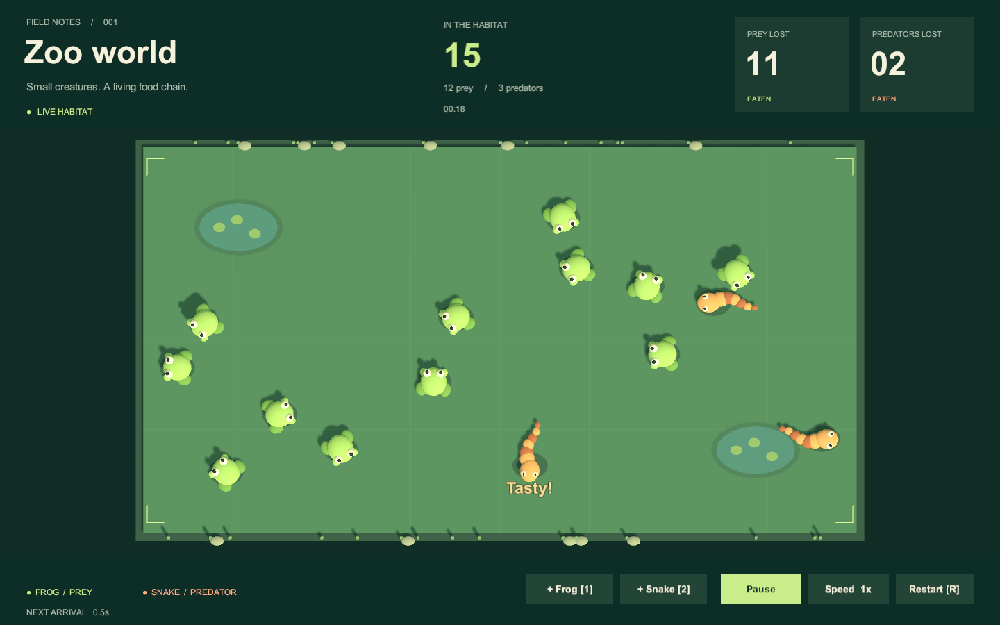

# Zoo World

A small 3D food-chain simulation made with **Unity 6000.4.6f1**. Frogs hop, snakes glide, and physics brings them together. All game UI, including the floating **Tasty!** labels, uses **uGUI**.



## Run

1. Open this folder with Unity **6000.4.6f1**.
2. Open `Assets/ZooWorld/Scenes/ZooWorld.unity`.
3. Press **Play**. The scene starts with 12 frogs and 4 snakes; one additional animal arrives every random **1–2 simulation seconds**.

| Control | Action |
| --- | --- |
| Space / Pause button | Pause or resume |
| 1 / + Frog | Add a frog |
| 2 / + Snake | Add a snake |
| Speed button | Switch between 1× and 2× |
| R / Restart | Clear the population and counters; start again |

The two counters at the **top right** count dead prey and dead predators separately. Predator duels are deterministic: the older living predator survives, regardless of callback order. No external art assets or ECS are used.

## Design

The main deliverable is an extensible animal architecture:

- **Domain**: plain C# life states, food-chain rules, population accounting, locomotion calculations and spawn scheduling. This assembly has no Unity references.
- **Runtime**: a reusable `AnimalAgent` adapts a locomotion strategy to a dynamic `Rigidbody`. `AnimalDefinition` assets compose a diet, prefab and movement asset. There are no frog/snake switches in the simulation or collision code.
- **Composition**: `ZooSimulation` explicitly constructs and injects its dependencies. No service locator, static singleton or runtime scene searches are needed.
- **Presentation**: event-driven uGUI counters, pooled labels and ordinary editable prefabs. Per-species object pools reuse dead animals with fresh life IDs.

See [Architecture](Documentation/Architecture.md) for extension instructions and tradeoffs, and [Requirements](Documentation/Requirements.md) for the task checklist.

## Add an animal

1. Create a prefab with `AnimalAgent`, a dynamic `Rigidbody` and a `SphereCollider`. Assign its visual and shadow transforms; keep visual-only geometry colliders off.
2. Reuse a movement asset, or derive `MovementDefinition` to create another `ILocomotion` strategy.
3. Use **Create → Zoo World → Animal Species**. Assign its prefab, movement, diet, mass, spawn weight and initial population.
4. Add that asset to `Assets/ZooWorld/Data/Simulation.asset` → **Species**.

That is enough for automatic spawning, pooling, food-chain interactions and counters. The manual buttons in the demo scene are optional shortcuts for its two supplied species.

## Validate and build

Use **Window → General → Test Runner** for EditMode and PlayMode tests. With the Unity CLI installed:

```sh
unity test . --mode EditMode --report-format nunit,junit --output TestResults/editmode.xml
unity test . --mode PlayMode --report-format nunit,junit --output TestResults/playmode.xml
unity build . --target StandaloneOSX --output-path Builds/macOS/ZooWorld.app
```

Close the project's Editor before a batch test/build; only one process can own its asset database. The demo content is already committed. **Tools → Zoo World → Rebuild demo content** recreates its assets and scene through the Unity Editor API; it overwrites demo content, so commit custom changes first.

Generated `Library`, logs, build output and test reports are ignored by Git. Unity `.meta` files, package locks, data, prefabs and the scene are committed. Only Unity packages are required; no separate DI framework or commercial assets need installing.
